* **Nama:** [Camelia Azzahra]
* **NIM:** [264107023014]
* **Kelas:** [Teknik Informatika - 2G]
==================================================================================
==================================================================================

# LAPORAN PRAKTIKUM PEMOGRAMAN WEB SEMESTER 3(2026) 

# Jobsheet 1-2 — HTML5 Semantic Skeleton
Sub-CPMK: Menyusun struktur halaman web dengan HTML5 semantic.

Isi tahap ini
index.html — Beranda dengan ringkasan statistik (dummy).
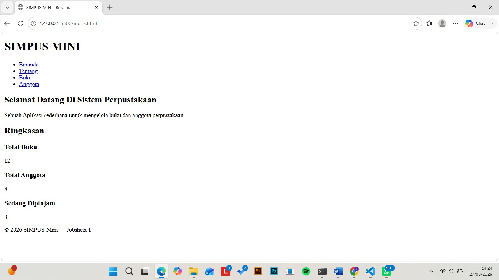
buku/list.html — tabel daftar buku statis (5 baris dummy).
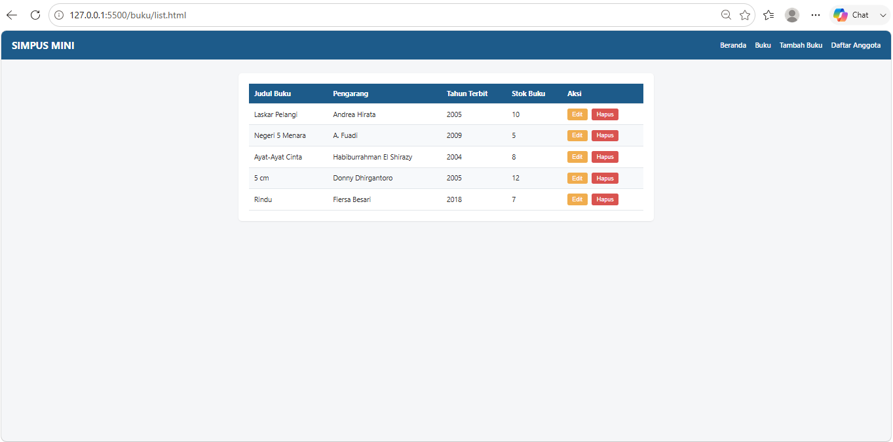
buku/tambah.html — form tambah buku (belum diproses).

anggota/list.html — tabel daftar anggota statis (tugas mandiri).

anggota/tambah.html — form tambah anggota (tugas mandiri).


# Jobsheet 3-4 
**SIMPUS MINI — Jobsheet 3: Responsive Design**

Aplikasi sistem informasi perpustakaan sederhana berbasis web (*SIMPUS MINI*) yang dikembangkan dengan pendekatan **Responsive Web Design** untuk mendukung berbagai ukuran layar (Desktop, Tablet, dan Mobile).

---

##  Sub-CPMK
**Membangun tampilan antarmuka web yang responsif.**

---

## Perubahan dari Jobsheet 2 ke Jobsheet 3

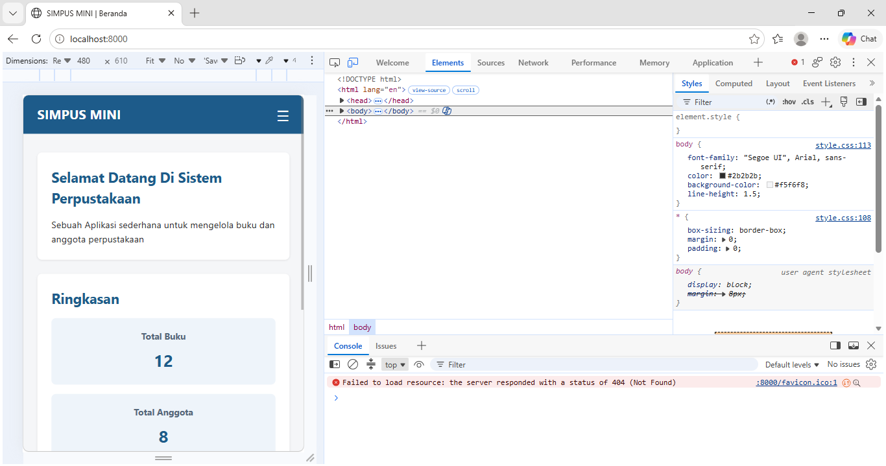

1. **Pengaturan Viewport Meta Tag**
   * Menambahkan `<meta name="viewport" content="width=device-width, initial-scale=1.0">` pada seluruh halaman HTML agar tata letak dan resolusi menyesuaikan skala layar perangkat.
   
2. **Hamburger Menu (Pure CSS Checkbox Hack)**
   * Mengimplementasikan teknik *checkbox hack* murni CSS (`input[type=checkbox]` + `label[for="..."]`) untuk membuat menu navigasi seluler interaktif tanpa JavaScript.
   * Aktif dan tampil otomatis pada ukuran layar **$\le 480\text{px}$** (atau breakpoint seluler).

3. **Responsivitas Tabel Data**
   * Pembungkusan elemen `<table>` dengan `<div class="table-responsive">` (`overflow-x: auto`) agar tabel dapat di-*scroll* secara horizontal di layar sempit tanpa merusak layout utama.

4. **Layout Grid Kartu Statistik Adaptif**
   * Penerapan Media Query (`@media`) pada `style.css` untuk mengubah layout kartu statistik secara bertahap:
     * **Desktop ($\ge 1024\text{px}$):** 4 Kolom
     * **Tablet ($\sim 768\text{px}$):** 2 Kolom
     * **Mobile ($\le 480\text{px}$):** 1 Kolom

---

## 🛠️ Cara Menjalankan & Pengujian

1. **Jalankan Aplikasi:**
   * Buka berkas `index.html` menggunakan peramban web (*browser*).
2. **Uji Responsivitas:**
   * Buka **Developer Tools** (`F12` atau `Ctrl + Shift + I`).
   * Aktifkan **Responsive Design Mode** (`Ctrl + Shift + M`).
   * Uji pada 3 *breakpoint* utama:
     - 📱 **Mobile:** $\le 480\text{px}$
     - 📱 **Tablet:** $\sim 768\text{px}$
     - 💻 **Desktop:** $\ge 1024\text{px}$

---

## 📝 Catatan Pengembangan
> **Catatan:** Fitur *hamburger menu* pada Jobsheet 3 ini masih murni menggunakan teknik CSS *checkbox hack*. Pada **Jobsheet 5**, mekanisme ini akan diperbarui menggunakan tombol *toggle* berbasis JavaScript.

---

# Jobsheet 4: UI/UX Design & Perancangan Sistem

---

## I. Pendahuluan & Pengantar
Pada Jobsheet 01 hingga 03, pembahasan berfokus pada teknik membedah baris kode HTML dan CSS. Namun, pada **Jobsheet 04 tidak ada perubahan kode HTML/CSS baru** (kodenya tetap sama persis dengan Jobsheet 03).

Jobsheet ini berfokus pada tahapan **UI/UX Design**, yaitu merancang antarmuka (*wireframe*) dan alur kerja pengguna (*user flow*) sebelum penulisan kode dilakukan. Pendekatan ini memastikan bahwa fitur-fitur kompleks seperti Login, Dashboard Petugas, Peminjaman, Pengembalian, dan Riwayat telah terencana dengan baik dari sisi alur dan struktur.

---

## II. Tujuan Praktikum
1. Memahami konsep dasar UI (*User Interface*) dan UX (*User Experience*) dalam pengembangan perangkat lunak.
2. Memahami cara membaca dan membuat *wireframe* (rancangan visual awal) serta *user flow* (alur pengguna).
3. Mengidentifikasi aktor sistem dan hak aksesnya (otorisasi).
4. Menyusun dokumen perancangan (`docs/wireframe.md`) sebagai acuan pengkodean fitur interaktif pada jobsheet berikutnya.

---

## III. Struktur Berkas Proyek
├── index.html              # Kode identik dengan Jobsheet 03
├── assets/css/style.css    # Kode identik dengan Jobsheet 03
├── buku/                    # Modul Buku (Jobsheet 03)
├── anggota/                 # Modul Anggota (Jobsheet 03)
├── docs/
│   └── wireframe.md         # [BARU] Rancangan UI/UX & Wireframe Fitur Baru
├── Infografis.png
├── README.md
└── Dokumentasi/             # Dokumentasi laporan

---

# LAPORAN PRAKTIKUM — JOBSHEET 5 
**Topik:** JavaScript DOM & Event (SIMPUS MINI)  

---

## Tujuan Praktikum
1. **Sub-CPMK:** Menerapkan manipulasi *Document Object Model* (DOM) dan penanganan *Event* pada JavaScript.
2. Mengubah mekanisme *hamburger menu* dari CSS *checkbox hack* menjadi fungsi *toggle* berbasis JavaScript (`classList.toggle`).
3. Menerapkan validasi *client-side* pada form (Tambah Buku & Tambah Anggota) dengan pesan *error inline* secara dinamis (`insertAdjacentElement`).
4. Mengimplementasikan fitur pencarian tabel *real-time* memanfaatkan event `keyup` (`initTableFilter`).
5. Menangani interaksi konfirmasi (`confirm()`) dan penghapusan baris tabel langsung dari antarmuka DOM.

---

## Perubahan Kode & Fitur Baru (Jobsheet 4 ke Jobsheet 5)

1. **Pembuatan File Logic (`assets/js/app.js`)**
   * Seluruh skrip JavaScript dipisahkan ke dalam berkas `assets/js/app.js` untuk menjaga kebersihan struktur HTML.
2. **Navigasi Interaktif (`nav.classList.toggle("nav-open")`)**
   * Menggantikan *checkbox hack* dengan event `click` pada tombol hamburger untuk menambahkan/menghapus kelas `.nav-open`.
3. **Validasi Form Client-Side (`initValidasiForm`)**
   * Pengecekan atribut wajib diisi, nilai tahun terbit, dan stok non-negatif sebelum form di-*submit*.
   * Menyisipkan elemen `<small class="error-msg">` tepat di bawah elemen input yang bermasalah.
4. **Filter Tabel Real-Time (`initTableFilter`)**
   * Menyaring elemen `<tr>` pada tabel Daftar Buku & Anggota setiap kali pengguna mengetik pada kolom pencarian (`keyup`).
5. **Hapus Baris Dengan Pop Up Konfirmasi (`.btn-hapus`)**
   * Memunculkan kotak dialog konfirmasi `confirm()`. Jika disetujui, baris elemen DOM terkait dihapus via `row.remove()`.

---

## Hasil Percobaan & Pengujian

Berikut adalah dokumentasi pengujian fitur-fitur baru pada Jobsheet 5:

### 1. Responsive Hamburger Menu (JS Toggle)
Menampilkan menu navigasi yang muncul/sembunyi saat tombol hamburger diklik pada ukuran layar seluler ($\le 480\text{px}$).

> **[Hasil Dokumentasi]**  
> *Contoh:* 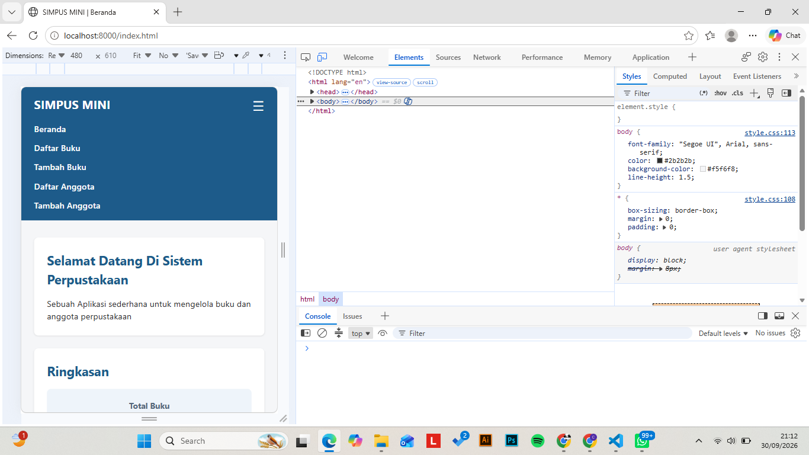

---

### 2. Validasi Form & Pesan Error Inline
Menampilkan pesan peringatan berwarna merah saat form dikirim dalam kondisi kosong atau input stok bernilai negatif.

> **[Hasil Dokumentasi]**  
> *Contoh:* 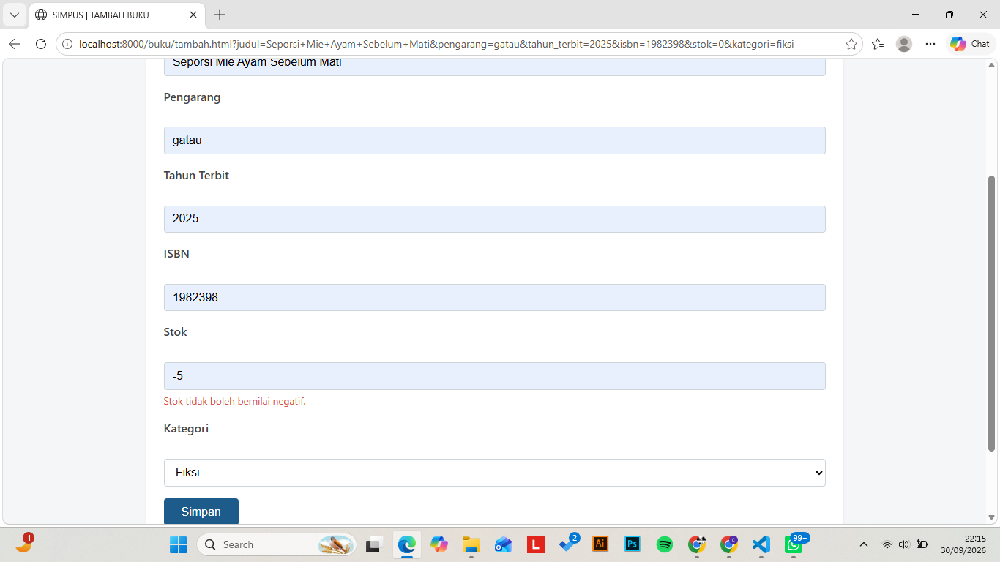

---

### 3. Pencarian Tabel Real-Time
Menampilkan hasil penyaringan baris tabel Daftar Buku / Anggota secara instan saat kata kunci diketik pada kolom pencarian.

> **[Hasil Dokumentasi]**  
> *Contoh:* 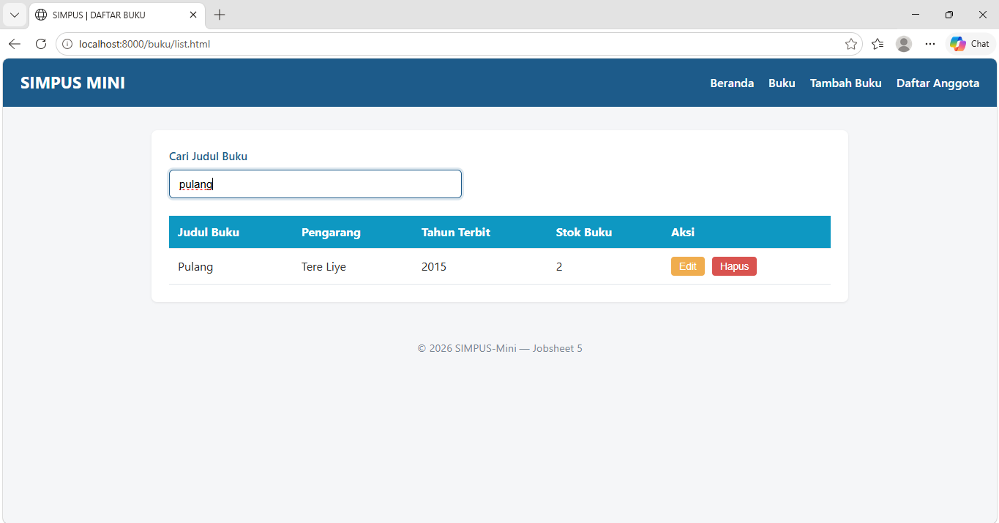

---

### 4. Pop-up Konfirmasi Hapus Data (`confirm()`)
Menampilkan kotak dialog konfirmasi bawaan peramban ketika tombol **Hapus** pada baris tabel diklik.

> **[Hasil Dokumentasi]**  
> *Contoh:* 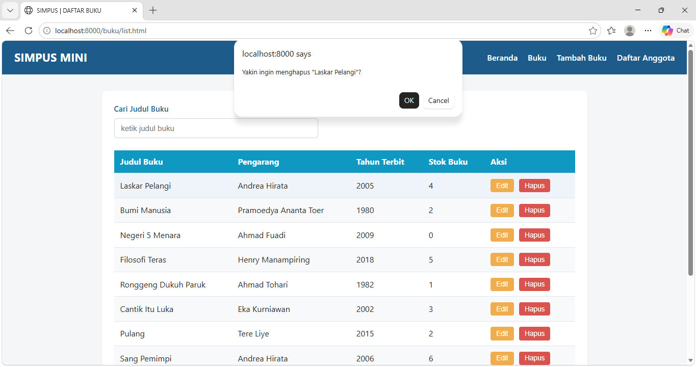

---

### 5. Penghapusan Baris dari DOM
Menampilkan kondisi tabel setelah salah satu baris berhasil terhapus dari antarmuka setelah dikonfirmasi.

> **[Sertakan Screenshot Baris Terhapus di Sini]**  
> *Contoh:* 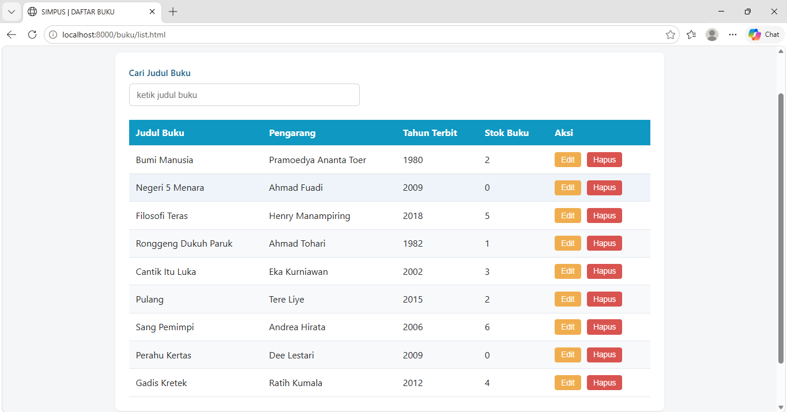

---

## Tabel Matriks Hasil Pengujian

| No | Fitur / Skenario Pengujian | Skenario Uji | Hasil yang Diharapkan | Status |
| :---: | :--- | :--- | :--- | :---: |
| **1** | **Hamburger Menu** | Klik ikon hamburger pada mode mobile. | Navigasi muncul/sembunyi secara fleksibel (`.nav-open`). | Berhasil |
| **2** | **Validasi Form Kosong** | Submit form tanpa mengisi input wajib. | Form ditahan, muncul pesan *error inline* di bawah input. | Berhasil |
| **3** | **Validasi Stok Negatif** | Masukkan angka negatif pada stok (misal: `-1`). | Tampil pesan error khusus stok tidak boleh negatif. | Berhasil |
| **4** | **Filter Tabel Real-time** | Ketik kata kunci di kolom cari. | Baris tabel menyaring otomatis sesuai kata kunci. | Berhasil |
| **5** | **Hapus Baris DOM** | Klik tombol "Hapus" $\rightarrow$ Klik OK. | Kotak konfirmasi muncul dan baris `<tr>` hilang dari layar. | Berhasil |

---

#  Kesimpulan & Catatan
* Implementasi JavaScript DOM & Event berhasil meningkatkan interaktivitas dan *User Experience* (UX) aplikasi **SIMPUS MINI**.
* **Catatan 1:** Validasi di jobsheet ini murni bersifat *client-side* (bisa dilewati jika JS dinonaktifkan). Lapisan keamanan kedua berupa validasi *server-side* akan ditambahkan pada **Jobsheet 7**.
* **Catatan 2:** Penghapusan baris data pada tabel saat ini baru sebatas manipulasi tampilan DOM *front-end* (belum tersimpan permanen di database). Proses manipulasi database sungguhan akan diimplementasikan mulai **Jobsheet 9**.

---

# LAPORAN PRAKTIKUM JOBSHEET 6
**Topik:** Komunikasi Asinkron (AJAX, JSON, Fetch API & Event Delegation)

---

## 1. Tujuan Praktikum
1. Memahami konsep komunikasi asinkron (AJAX) dan pertukaran data terstruktur menggunakan format **JSON**.
2. Mengimplementasikan fungsi **`fetch()`**, **Promise**, serta penggunaan sintaks **`async/await`** di JavaScript.
3. Mengaplikasikan struktur blok **`try...catch...finally`** untuk menangani kegagalan pengambilan data melalui jaringan.
4. Menerapkan pola **Event Delegation** pada objek `document` untuk menangani aksi interaktif (*event listener*) pada elemen DOM yang dibuat secara dinamis.
5. Memahami pentingnya menjalankan aplikasi berbasis Fetch API di lingkungan server lokal (*HTTP protocol*) untuk menghindari isu CORS (*Cross-Origin Resource Sharing*).

---

## 2. Ringkasan Konsep Kunci
- **AJAX & JSON:** AJAX memungkinkan pembaruan bagian tertentu pada halaman web tanpa perlu *reload* seluruh halaman. Data yang ditukarkan menggunakan format teks JSON berbasis *key-value*.
- **`fetch()` & `async/await`:** `fetch()` mengembalikan sebuah *Promise*. Kata kunci `await` (di dalam `async function`) digunakan untuk menunggu hingga proses pengambilan data selesai tanpa memblokir antarmuka pengguna (*non-blocking*).
- **`try...catch...finally`:** Menjaga aplikasi agar tidak *crash* ketika terjadi kesalahan jaringan atau file data tidak ditemukan, serta memastikan indikator *loading* disembunyikan setelah proses selesai.
- **Event Delegation:** Teknik menempelkan *event listener* pada elemen leluhur yang stabil (`document`) untuk menangkap *event bubbling* dari elemen anak yang baru dirender secara dinamis.

---

## 3. Hasil Implementasi Kode

### Analisis Hasil Pengujian & Bukti Praktikum
**Loading State & Render Data**
1. Ketika halaman buku/list.html diakses via web server (http://localhost:8000), indikator #loading-indicator tampil selama 600 milidetik.
*Contoh:* 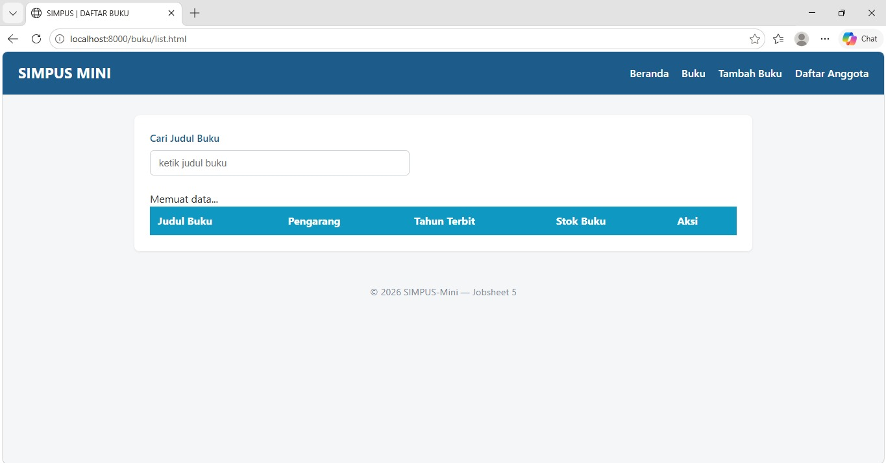

2. Setelah Promise dari fetch() selesai (resolved), data dari buku.json dirender secara otomatis ke dalam elemen <tbody>.
*Contoh:* 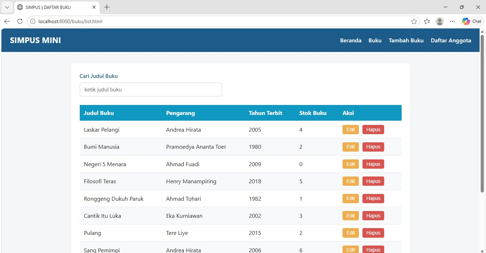

**Pengujian Penanganan Error (try...catch)**
3. Ketika lokasi URL diubah ke file yang tidak ada (../data/buku_salah.json), fungsi melempar kesalahan (throw Error) yang ditangkap oleh blok catch. Tampilan tabel menunjukkan pesan kesalahan warna merah tanpa menghentikan eksekusi skript JavaScript lainnya.
*Contoh:* 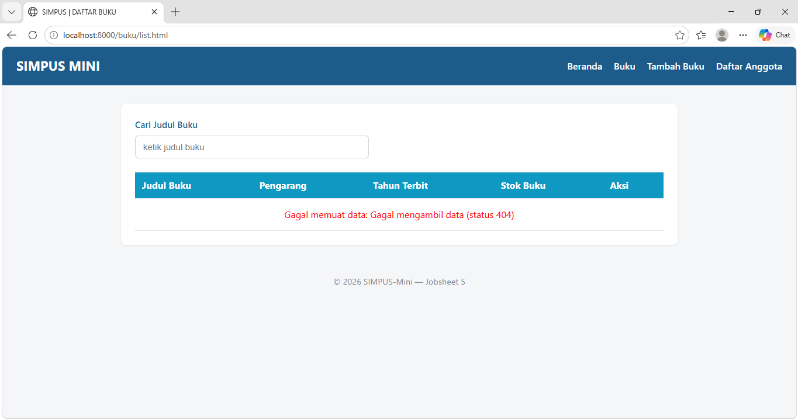

**Pengujian Event Delegation (Tombol Hapus Dinamis)**
4. Tombol .btn-hapus yang dibuat setelah proses fetch() berhasil mendeteksi perintah klik pengguna.

5. Sinyal klik menjalar (event bubbling) hingga ke elemen document.

6. Fungsi e.target.closest(".btn-hapus") memfilter klik secara akurat dan menampilkan dialog konfirmasi confirm().
*Contoh:* 
*Contoh:* 

---

###  KESIMPULAN
1. Pemanggilan data secara asinkron menggunakan Fetch API dan async/await menghasilkan antarmuka pengguna yang responsif tanpa perlu reload halaman secara keseluruhan.

2. Penggunaan Event Delegation merupakan solusi terbaik untuk mengelola interaksi pada elemen DOM yang dibuat secara dinamis setelah proses initial load (DOMContentLoaded).

3. Pengujian pemanggilan data asinkron berbasis protokol HTTP/HTTPS membutuhkan lingkungan server lokal untuk menghindari pembatasan akses berkas (CORS policy).

---

# LAPORAN PRAKTIKUM jobsheet 7

## 1. PENDAHULUAN & TUJUAN PRAKTIKUM

Pada Jobsheet 7 ini, proyek **SIMPUS-Mini** mengalami transisi arsitektur secara fundamental dari *Client-Side Application* (HTML statis, JavaScript, dan `fetch()` data JSON) menjadi *Server-Side Application* berbasis **PHP**.

### Tujuan Pembelajaran:
1. **Memahami Konsep Server-Side Processing:** Memahami perbedaan fundamental antara pemrosesan di browser (*client-side*) dan pemrosesan di server (*server-side*).
2. **Implementasi Modularisasi Layout (`includes/`):** Menggunakan fungsi `include` untuk memisahkan bagian halaman yang berulang (`header.php` dan `footer.php`) guna menerapkan prinsip *Don't Repeat Yourself* (DRY).
3. **Manajemen Path Relatif Dinamis (`$base`):** Mengatur jalur relatif untuk file CSS, JS, dan tautan navigasi agar tetap valid saat diakses dari folder *root* maupun *subfolder*.
4. **Pengolahan Form dan Metode POST:** Mengirim data inputan user secara aman melalui metode `POST` ke skrip pemroses (`proses_tambah.php`).
5. **Validasi Server-Side:** Menerapkan validasi data di sisi server yang independen dari validasi JavaScript/browser.
6. **Manajemen Sesi Sementara (`$_SESSION`):** Mengelola penyimpanan data sementara lintas halaman menggunakan variabel superglobal `$_SESSION`.
7. **Penerapan Flash Message:** Memberikan umpan balik (notifikasi sukses/error) sekali-tampil kepada pengguna menggunakan mekanisme `unset()`.

---

## 2. PERUBAHAN UTAMA DARI JOBSHEET 6

| Fitur / Komponen | Jobsheet 6 (Client-Side / JSON) | Jobsheet 7 (Server-Side / PHP) |
| :--- | :--- | :--- |
| **Ekstensi File** | `.html` | `.php` |
| **Sumber Data** | File statis `data/buku.json` & `data/anggota.json` | Memori server via `$_SESSION` |
| **Rendering Tabel** | JavaScript (`assets/js/buku.js` via `fetch()`) | Server-Side PHP (`foreach` di `list.php`) |
| **Pengiriman Form** | Event Listener JavaScript (`submit`) | Native Form `method="POST"` ke `proses_tambah.php` |
| **Validasi Form** | Client-side JS (`app.js` / HTML5 attributes) | Server-side PHP (`is_numeric()`, `trim()`, dll) |
| **Tata Letak (Layout)** | Duplikasi `<header>` & `<footer>` di tiap file | Modular via `includes/header.php` & `footer.php` |
| **File Dihapus** | `assets/js/buku.js`, `assets/js/anggota.js`, folder `data/` | *Dihapus karena rendering sudah ditangani penuh oleh PHP* |

---

## 3. PENJELASAN KONSEP & IMPLEMENTASI KODE

### A. Modularisasi Layout dan Manajemen `$base`
Untuk menghindari penulisan tag `<header>` dan `<footer>` secara berulang-ulang, bagian navigasi dan struktur dasar HTML dipisah ke dalam folder `includes/`.

* **`includes/header.php`**: Berisi deklarasi `<!DOCTYPE html>`, tag `<head>`, pemanggilan CSS, `<nav>`, dan membuka tag `<main>`.
* **`includes/footer.php`**: Berisi penutup tag `</main>`, tag `<footer>`, pemanggilan JS `app.js`, dan penutup `</body></html>`.
* **Peran Variabel `$base`**:
  Setiap file menentukan kedalaman foldernya:
  * Di `index.php` (Root): `$base = "";`
  * Di `buku/list.php` atau `anggota/tambah.php` (Subfolder): `$base = "../";`
  
  Dengan variabel `$base`, tautan stylesheet `<link rel="stylesheet" href="<?php echo $base; ?>assets/css/style.css">` akan selalu menunjuk ke lokasi yang benar, baik saat dijalankan melalui `php -S localhost:8000` maupun Laragon Virtual Host.

---

### B. Pemrosesan Form dan Validasi Server (`proses_tambah.php`)
Ketika pengguna menekan tombol "Simpan" pada `tambah.php`, data dikirim menggunakan metode `POST`. 

#### Alur Kerja `buku/proses_tambah.php`:
1. **Penerimaan & Pembersihan Data:**  
   Menerima data dengan operator Null Coalescing (`?? '')` untuk mencegah error *undefined index*, lalu membuang spasi kosong di awal/akhir menggunakan `trim()`.
   ```php
   $judul        = trim($_POST['judul'] ?? '');
   $pengarang    = trim($_POST['pengarang'] ?? '');
   $tahun_terbit = $_POST['tahun_terbit'] ?? '';
   $stok         = $_POST['stok'] ?? '';

   HASIL PENGUJIAN & ANALISIS
Pengujian Tambah Data (Valid):

Mengisi form tambah buku dengan data yang benar.

Hasil: Sistem berhasil me-redirect ke list.php, menampilkan flash message berwarna hijau "Buku berhasil ditambahkan.", dan data baru muncul pada baris tabel.

Pengujian Refresh Halaman:

Me-refresh halaman list.php.

Hasil: Flash message hilang, tetapi data pada tabel tidak hilang.

Pengujian Validasi Server (Form Kosong):

Mengosongkan field input lalu menekan tombol "Simpan".

Hasil: Sistem tidak menyimpan data, me-redirect kembali ke tambah.php, dan menampilkan flash message error berwarna merah.

Pengujian Nonaktifkan JavaScript (Uji Keamanan Server):

Mematikan fitur JavaScript pada pengaturan browser, lalu mengirimkan form kosong.

Hasil: Validasi server di proses_tambah.php tetap berjalan 100%. Hal ini membuktikan bahwa validasi server-side tidak dapat dimanipulasi dari sisi klien/browser.

Pengujian Penutupan Browser:

Menutup seluruh jendela browser lalu membukanya kembali.

Hasil: Data pada tabel kembali kosong. Hal ini membuktikan sifat penyimpanan $_SESSION yang bersifat sementara per sesi browser.

6. KESIMPULAN
Melalui praktikum Jobsheet 7 ini, beberapa kesimpulan penting yang diperoleh antara lain:

Server-Side Rendering Lebih Terkontrol: Pengolahan data dan struktur HTML yang dibangun di server memberikan kontrol penuh serta keamanan yang lebih tinggi dibanding client-side rendering.

Modularisasi Kode Meningkatkan Efisiensi: Pemisahan komponen ke header.php dan footer.php mempermudah pemeliharaan kode (maintenance). Jika ada perubahan navigasi, perubahan cukup dilakukan di satu file.

Validasi Server Adalah Pertahanan Utama: Validasi JavaScript bermanfaat untuk kenyamanan user interface, namun validasi PHP di server adalah garda terdepan keamanan data yang tidak boleh dilewati.

Session Sebagai Media Transit: $_SESSION sangat efektif digunakan sebagai penampung data sementara dan media


# LAPORAN PRAKTIKUM - Jobsheet 8
**SIMPUS-Mini: Koneksi Database PostgreSQL**

---

## 1. Pendahuluan & Tujuan Praktikum

Pada praktikum sebelumnya (Jobsheet 7), penyimpanan data aplikasi masih bersifat sementara menggunakan `$_SESSION`, sehingga data akan hilang begitu sesi browser ditutup atau komputer dimatikan. Jobsheet 8 bertujuan untuk mengatasi keterbatasan tersebut dengan mengintegrasikan database relasional **PostgreSQL** sebagai media penyimpanan data permanen (*persistent storage*).

### Tujuan Pembelajaran:
* Memahami konsep dasar database relasional dan penggunaan sintaks SQL (*Data Definition Language* & *Data Manipulation Language*).
* Menghubungkan aplikasi PHP ke database PostgreSQL menggunakan **PDO (PHP Data Objects)**.
* Menerapkan **Prepared Statements** pada operasi `INSERT` untuk mencegah celah keamanan *SQL Injection*.
* Mengubah alur pembacaan data (`SELECT`) dan perhitungan statistik (`SELECT COUNT(*)`) agar bersumber dari database sungguhan.

---

## 2. Struktur Proyek

```text
jobsheet-08/
├── index.php                      # Kartu statistik dari SELECT COUNT(*)
├── includes/
│   ├── header.php, footer.php     # Template antarmuka
│   └── koneksi.php                 # BARU — Koneksi PDO ke PostgreSQL
├── sql/
│   └── 01_buku_anggota.sql         # BARU — Skema tabel buku & anggota
├── buku/
│   ├── list.php                    # SELECT * FROM buku (bukan $_SESSION)
│   ├── tambah.php                  # Form tambah buku
│   └── proses_tambah.php           # INSERT via prepared statement
├── anggota/
│   ├── list.php                    # SELECT * FROM anggota
│   ├── tambah.php                  # Form tambah anggota
│   └── proses_tambah.php           # INSERT via prepared statement
├── docs/wireframe.md               # Dokumentasi antarmuka
└── README.md
```

## Hasil Praktikum
Hasil yang Dicapai:
1. Penyimpanan Permanen: Data buku dan anggota yang diinput melalui form web berhasil tersimpan ke dalam tabel PostgreSQL dan tidak hilang saat browser atau server dimatikan.
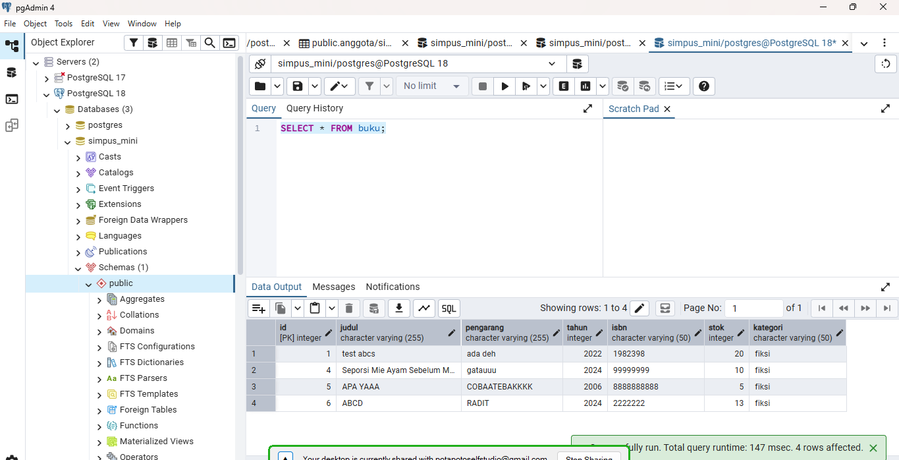

2. Koneksi Web Server: Aplikasi dapat diakses dengan stabil melalui server Apache Laragon pada port kustom (:8080).


3. Penyampaian Notifikasi (Flash Message): Sistem berhasil memberikan feedback notifikasi interaktif setelah operasi INSERT berhasil.
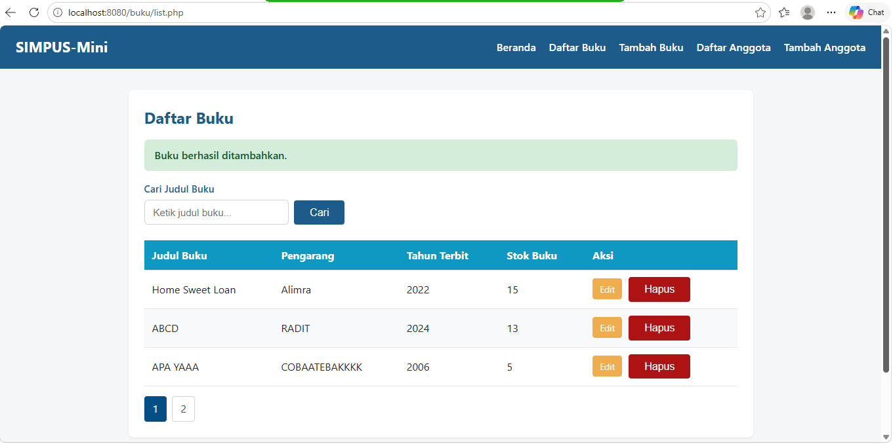

## 5. Kesimpulan
Praktikum Jobsheet 8 berhasil mentransisikan sistem penyimpanan data pada aplikasi SIMPUS-Mini dari berbasis sesi sementara ($_SESSION) menjadi berbasis database relasional (PostgreSQL). Penggunaan PDO dan Prepared Statements memastikan bahwa aplikasi tidak hanya dapat menyimpan data secara permanen, tetapi juga memiliki fondasi keamanan yang kuat terhadap potensi serangan SQL Injection.