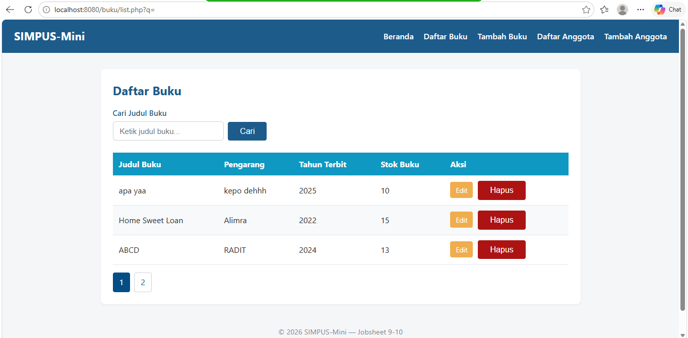
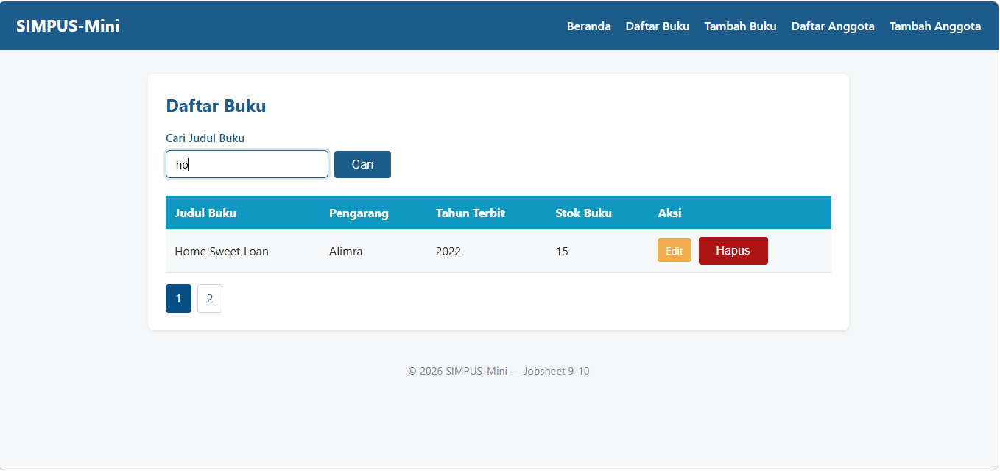

* **Nama:** [Camelia Azzahra]
* **NIM:** [264107023014]
* **Kelas:** [Teknik Informatika - 2G]
=======================================================================
=======================================================================

# LAPORAN PRAKTIKUM PEMOGRAMAN WEB SEMESTER 3

# JOBSHEET 9

## 1. Tujuan Praktikum
* Melengkapi fitur aplikasi dengan dua operasi terakhir dari siklus CRUD, yaitu **Update (Ubah)** dan **Delete (Hapus)**.
* Menerapkan praktik keamanan basis data menggunakan prepared statements serta klausul pengaman (`WHERE`) pada operasi perubahan dan penghapusan data.
* Mengamankan proses penghapusan data dengan mewajibkan metode HTTP `POST` guna mencegah eksekusi tidak disengaja oleh *crawler* atau tautan eksternal.
* Mengimplementasikan **Pagination** (`LIMIT`/`OFFSET`) dan **Pencarian Sisi Server** (`WHERE ... ILIKE ...`) untuk menangani volume data yang besar.

---

## 2. Sub-CPMK
* Membangun dan mengintegrasikan fitur CRUD penuh pada proyek web berbasis PHP dan PostgreSQL.

---

## 3. Perubahan Utama dari Jobsheet 8
Sesuai dengan pembaruan pada Jobsheet 9, berikut adalah komponen baru yang ditambahkan:
* **Fitur Update:** Penambahan file `buku/edit.php`, `buku/proses_edit.php`, `anggota/edit.php`, dan `anggota/proses_edit.php` yang berfungsi menampilkan data lama ke dalam form serta menyimpan perubahannya ke database.
* **Fitur Delete:** Penambahan file `buku/hapus.php` dan `anggota/hapus.php` yang dikonfigurasi khusus hanya menerima metode HTTP `POST`.
* **Transformasi Tombol Hapus:** Tombol hapus di halaman `list.php` diubah dari tombol polos biasa menjadi elemen `<form class="form-hapus" method="post">` sungguhan.
* **Konfirmasi JavaScript:** Skrip pada `assets/js/app.js` (`initHapusConfirm`) disesuaikan agar menangani dialog konfirmasi pada *event* `submit` (sehingga mendukung fungsi `preventDefault()`), menggantikan *event click* sebelumnya.
* **Pagination & Server-side Search:** Halaman `list.php` pada modul buku dan anggota kini dilengkapi dengan penomoran halaman (`LIMIT`/`OFFSET`, 5 baris per halaman) serta pencarian berbasis server (`WHERE ... ILIKE ...`) menggunakan form metode `GET`.

---

## 4. Struktur Folder Proyek

```text
jobsheet-09/
├── index.php
├── includes/                         # Berisi file header.php, footer.php, koneksi.php
├── buku/
│   ├── list.php                      # Read + Pagination + Server Search + Form Hapus
│   ├── tambah.php, proses_tambah.php # Create (dari Jobsheet 8)
│   ├── edit.php                      # BARU — Form Edit terisi data lama
│   ├── proses_edit.php               # BARU — Proses UPDATE ke database
│   └── hapus.php                     # BARU — Proses DELETE (Proteksi POST)
├── anggota/                          # Struktur paralel dengan folder buku/
│   ├── list.php, tambah.php, proses_tambah.php
│   ├── edit.php, proses_edit.php, hapus.php
├── assets/
│   ├── css/style.css                 # Styling tambahan (btn-edit, pagination, form)
│   └── js/app.js                     # Logika konfirmasi hapus via event submit
├── docs/wireframe.md                 # Dokumentasi UI/UX (identik Jobsheet 8)
└── README.md
```

## 4. Hasil Praktikum
### 4.1 Update Data (edit.php & proses_edit.php)
Mengambil parameter ID dari URL ($_GET['id']) untuk melakukan kueri pencarian data lama.

Menampilkan data tersebut ke dalam atribut value="..." di dalam form HTML.

Mengeksekusi perintah SQL UPDATE ... SET ... WHERE id = :id secara aman untuk memperbarui data di database PostgreSQL.

**Bukti Implementasi Kode**
```// Mengambil data lama berdasarkan ID
$id = $_GET['id'] ?? null;
$stmt = $pdo->prepare("SELECT * FROM buku WHERE id = :id");
$stmt->execute(['id' => $id]);
$buku = $stmt->fetch(PDO::FETCH_ASSOC);
```
```// 4. Jalankan UPDATE jika data valid
$stmt = $pdo->prepare(
    "UPDATE buku SET 
        judul = :judul, 
        pengarang = :pengarang, 
        tahun = :tahun, 
        isbn = :isbn, 
        stok = :stok, 
        kategori = :kategori 
     WHERE id = :id"
);
```

### 4.2 Delete Data (hapus.php)
Membatasi akses skrip penghapusan dengan memvalidasi $_SERVER['REQUEST_METHOD'] === 'POST'. Hal ini mencegah data terhapus secara tidak sengaja apabila URL diakses langsung melalui address bar.
**Bukti Implementasi Kode**

// Sengaja hanya menerima POST (bukan GET) agar penghapusan tidak bisa dipicu tanpa sengaja lewat link/preview crawler.
```if ($_SERVER['REQUEST_METHOD'] !== 'POST') {
    header('Location: list.php');
    exit;
}

$id = $_POST['id'] ?? null;
if ($id) {
    $stmt = $pdo->prepare("DELETE FROM buku WHERE id = :id");
    $stmt->execute(['id' => $id]);
    $_SESSION['flash'] = ['type' => 'success', 'message' => 'Buku berhasil dihapus.'];
}

header('Location: list.php');
exit;
```

### 4.3 Pagination & Pencarian Sisi Server
Pagination: Menggunakan parameter LIMIT (jumlah baris per halaman, yaitu 3) dan OFFSET (titik awal data) yang diikat menggunakan tipe data integer (PDO::PARAM_INT).

Pencarian Server-side: Memanfaatkan operator ILIKE pada PostgreSQL agar proses pencarian bersifat case-insensitive (tidak membedakan huruf besar dan kecil) serta mampu mencari data lintas seluruh halaman.

**Bukti Implementasi Kode**
```$perPage = 5;
$page = max(1, (int) ($_GET['page'] ?? 1));
$offset = ($page - 1) * $perPage;
$keyword = trim($_GET['q'] ?? '');

if ($keyword !== '') {
    $stmt = $pdo->prepare("SELECT * FROM buku WHERE judul ILIKE :kw OR pengarang ILIKE :kw ORDER BY id DESC LIMIT :limit OFFSET :offset");
    $stmt->bindValue('kw', '%' . $keyword . '%');
} else {
    $stmt = $pdo->prepare("SELECT * FROM buku ORDER BY id DESC LIMIT :limit OFFSET :offset");
}
$stmt->bindValue('limit', $perPage, PDO::PARAM_INT);
$stmt->bindValue('offset', $offset, PDO::PARAM_INT);
$stmt->execute();
$daftarBuku = $stmt->fetchAll(PDO::FETCH_ASSOC);
```
**Hasil Implementasi**




## 6. Cara Menjalankan Aplikasi
**Opsi 1 — Menggunakan PHP Built-in Server**
* Buka terminal atau command prompt, lalu arahkan direktori ke folder proyek.

* Jalankan perintah:
`` php -S localhost:8000 ``

* Buka browser dan akses: http://localhost:8080/index.php.

## Kesimpulan
Berdasarkan praktikum yang telah dilakukan pada Jobsheet 9, dapat disimpulkan bahwa:

**Penyempurnaan Siklus CRUD:** Aplikasi SIMPUS-Mini kini memiliki fungsionalitas penuh yang mencakup Create, Read, Update, dan Delete. Fitur Update mmembuat proses pengubahan data menjadi lebih aman, sementara fitur Delete dilindungi menggunakan metode HTTP POST untuk mencegah eksekusi penghapusan yang tidak disengaja.

**Pencarian & Halaman Lebih Rapi:** Dengan adanya fitur Pagination (pembatas halaman) dan pencarian langsung dari server (ILIKE), aplikasi jadi lebih ringan dan bisa mencari data di semua halaman dengan mudah.

**Peningkatan Pengalaman Pengguna & Keamanan:** Integrasi antarmuka melalui penyesuaian gaya CSS tombol aksi (Edit dan Hapus) serta validasi konfirmasi berbasis event submit pada JavaScript berhasil menciptakan alur interaksi aplikasi yang lebih nyaman dan aman.

# JOBSHEET 10

